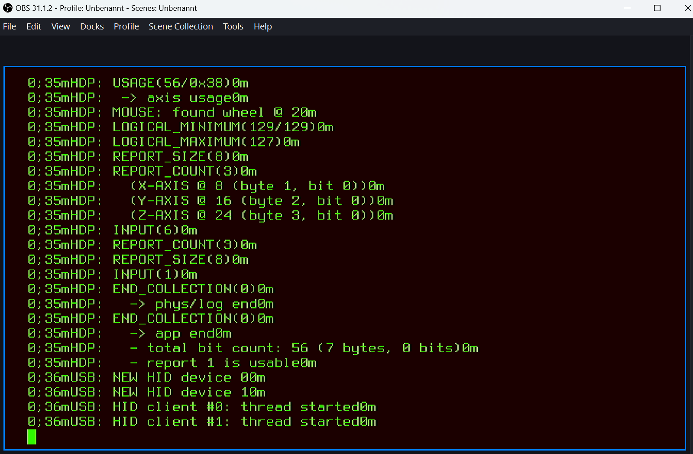

# Tang Onboard BL616 Debug Console Display

This FPGA core is designed specifically for the [FPGA-Companion](https://github.com/MiSTle-Dev/FPGA-Companion) firmware running on the **onboard BL616 microcontroller** of a Tang FPGA board.

It displays the 2 Mbaud debug console on an HDMI monitor using a [VT52-style terminal](https://en.wikipedia.org/wiki/VT52) and supports interaction with the firmware's shell.
It is useful for diagnosing USB hub and USB HID detection or compatibility issues.

Alternatively, you can access the console with a USB-UART adapter and a terminal program such as PuTTY or minicom. See [External UART adapter](#external-uart-adapter). This project is primarily intended for users who do not have a USB-UART adapter available.

The core can also serve as a template for terminal-based retro projects.

## Prerequisite

Install [FPGA-Companion](https://github.com/MiSTle-Dev/FPGA-Companion/releases) on your Tang board's onboard BL616 microcontroller.

## Getting started

Program the FPGA with the debug core that matches your Tang board: `bl616monitor_xyz.fs`.

Power the Tang board through a USB hub with power pass-through, or supply the TN20K directly through its +5V and GND pins. Start with **no other USB devices connected**.

A green VT52-style terminal will appear on your HDMI monitor, displaying FPGA-Companion debug messages.

The display uses 80 columns by 25 rows of 8x16-pixel characters (640x400 pixels).

ANSI color/formatting sequences such as `ESC[0;33m` and `ESC[0m` are consumed
without displaying their bytes; the display remains green. Other ANSI CSI
sequences are also discarded, not executed.

Connect a USB HID device, such as a keyboard, mouse, joystick, or gamepad.
Each device should generate a registration message containing information such as its USB VID:PID.
Messages can arrive very quickly, and the terminal has no scrollback buffer. Recording the screen with your phone can help you review them.

Joystick or gamepad button presses and stick movements generate debug messages.
Keyboard and mouse activity does not generate debug messages beyond the initial device registration.

Use the keyboard to enter shell commands such as `help` or `lsusb` in lowercase.

- Press button **S2** to observe the microcontroller's boot messages.
- Press button **S1** to open the on-screen display (OSD).

## External UART adapter

|Signal     |TN20k| TP25k    |TM60k|TM138k Pro|Console 60k/138k|
|   -       |-    |  -       | -   | -        |-               |
|UART TX out|48   |L6 USB-A +|tbd  |B21       |R14             |
|UART RX in |55   |N/A       |tbd  |C21       |P14             |

## Primer 25K

The UART TX monitoring output is connected to the USB-A D+ pin. No UART RX monitoring input is available by default.
To allow the BL616 to receive UART console input, the following hardware modifications are required:

- Remove capacitor C22 from the dock to avoid signal integrity issues.
- Connect the USB-A D- pin to the signal-side pad exposed by removing C22. This creates an additional connection between the FPGA and the BL616 microcontroller, while leaving the middle PMOD available for two DualShock 2 gamepads or a retro DB9 joystick.

## Credits

Uses source code from [vt52-fpga](https://github.com/AndresNavarro82/vt52-fpga).
